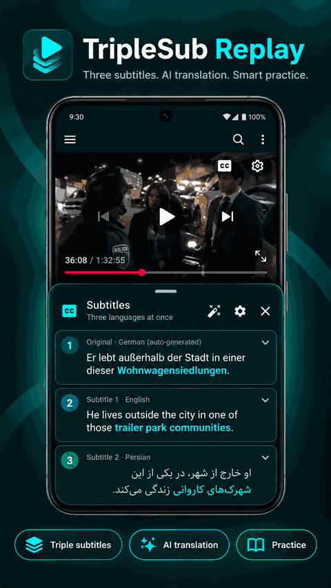

# TripleSub Replay

**Learn languages with YouTube, three subtitle lines, AI-assisted translation, and vocabulary practice on Android.**

**[Download APK](https://github.com/mrAlishah/triple-sub-replay/releases/latest)** · **[Start here](docs/user-guide/getting-started.md)** · **[User guide](docs/user-guide/README.md)** · **[What's new](docs/releases/README.md)** · **[Fork changelog](myCHANGELOG.md)**

> **Which app is this?** TripleSub Replay is a customized fork maintained at [mrAlishah/triple-sub-replay](https://github.com/mrAlishah/triple-sub-replay/tree/mydevelop). It builds on [DualSub Replay](https://github.com/hoangkien1703/dual-sub-replay) by Hoang Trung Kien. Download **TripleSub-Replay.apk** from this fork's Releases; the original project's APK and releases are a different distribution.

## What you can do

- **Watch with up to three subtitle lines:** Original Subtitle, Subtitle 1 and Subtitle 2, with independent languages, size, order and alignment.
- **Replay a line:** use its **Play** button to seek and play that sentence. In current development builds, tapping the card body is not the Play action.
- **Translate your way:** Google Translate, AI translation (best quality), AI only, or on-device translation; availability depends on the build and your configuration.
- **Look up, save and practice words:** learn meanings in multiple languages, retain source-video context and review saved vocabulary.
- **Use AI for language learning:** supported AI translation and assistant features depend on configured connections, credentials and build version.
- **Send vocabulary to AnkiDroid and import/export your study data.**
- **Open multiple YouTube tabs:** up to 10 tabs with device-dependent multi-account support.

See the [illustrated user guide](docs/user-guide/README.md) for each workflow.

## Animated feature tour (illustration)

  

*Six AI-generated promotional illustrations provided by the project owner, shown as a looping feature tour — **not a screen recording or pixel-exact app UI**. Per-segment AI refresh and some chat controls are development features and may not be in the latest published APK. Actual historical APK screenshots are below.*

## Real app screenshots

These are **real screenshots previously published with fork APK releases**, not mock-ups. They depict the indicated historical versions, so current development menus may differ.

## Install or update

1. Open **[TripleSub Replay Releases](https://github.com/mrAlishah/triple-sub-replay/releases/latest)**.
2. Under **Assets**, download `TripleSub-Replay.apk` (not `DualSub-Replay.apk`).
3. On Android 8.0 or later, open the file and allow installation from that source if Android asks.
4. To update an installed copy, use a newer fork APK **only if package ID and signing certificate match**. Otherwise Android may refuse to update it. **Back up Practice data first**.
5. If you want to verify the download, compare its SHA-256 with the accompanying `TripleSub-Replay.apk.sha256` asset.

The fork's own update checker is intended to use fork releases. If an update cannot be installed, do not uninstall the old copy before exporting your study data. See [installation help](docs/user-guide/getting-started.md) and [troubleshooting](docs/user-guide/troubleshooting.md).

## Quick start

1. Open a YouTube video with captions.
2. Open **Subtitle languages** and choose the **Original Subtitle**, **Subtitle 1** and, optionally, **Subtitle 2**.
3. Choose your subtitle display and translation mode in Settings.
4. Use a subtitle row's **Play** button to replay it; select words for meaning and learning actions.
5. Save useful words or phrases, then open **Practice** to review them.
6. If you want AI translation or chat, configure **AI Connection** and choose the relevant service.

**[Follow the step-by-step guide](docs/user-guide/getting-started.md)**

## development features
The `mydevelop` branch may contain **newer, unreleased customizations** such as additional AI Connection workflows, ChatGPT Subscription chat integration, and a per-segment **Re-translate with AI** menu. Their presence in source or current screenshots does **not** guarantee they are in the latest released APK. Read [Unreleased](myCHANGELOG.md) and the [guide's build-status note](docs/user-guide/README.md) before relying on them.

## Documentation

| Read | Purpose |
| --- | --- |
| [Getting started](docs/user-guide/getting-started.md) | Install, update and first video |
| [Triple subtitles](docs/user-guide/triple-subtitles.md) | Languages, layouts and replay |
| [Translation & AI](docs/user-guide/ai-translation.md) | Translation modes, connections and refresh |
| [AI Assistant](docs/user-guide/ai-assistant.md) | Chat about words, subtitles and the app |
| [Practice & vocabulary](docs/user-guide/practice.md) | Save, filter and review |
| [Anki & backups](docs/user-guide/anki-backup.md) | Export, import and AnkiDroid |
| [Troubleshooting](docs/user-guide/troubleshooting.md) | Common questions and safe recovery |
| [Release history](docs/releases/README.md) | Changes and historical screenshots |
| [Full fork changelog](myCHANGELOG.md) | Technical and unreleased change history |

## Privacy and limitations

Subtitles may be sent to Google Translate or your selected AI provider when you enable those features. **On this device only** avoids online subtitle-translation requests, although YouTube video and caption access still uses the network. The app's translation options and AI-provider eligibility vary by version and configuration. Saved words contain learning content; treat exported backups as private.

YouTube caption retrieval and playback depend on the embedded YouTube experience and may change as YouTube changes. See [Privacy](PRIVACY.md), [troubleshooting](docs/user-guide/troubleshooting.md) and the release notes.

## Fork, original project and credits

| Project | Source | Releases | Website |
| --- | --- | --- | --- |
| **TripleSub Replay (customized fork)** | [`mydevelop`](https://github.com/mrAlishah/triple-sub-replay/tree/mydevelop) | [Fork APK releases](https://github.com/mrAlishah/triple-sub-replay/releases) | — |
| **DualSub Replay (original)** | [Original repository](https://github.com/hoangkien1703/dual-sub-replay) | [Original releases](https://github.com/hoangkien1703/dual-sub-replay/releases) | [Original project website](https://hoangkien1703.github.io/dual-sub-replay/) |

**Original project and author:** DualSub Replay by **Hoang Trung Kien** and its contributors. TripleSub Replay includes fork-specific customizations by **mrAlishah**. This repository retains the original authors' license and notices; see [LICENSE](LICENSE) and [THIRD_PARTY_NOTICES.md](THIRD_PARTY_NOTICES.md). The original upstream repository remains the authoritative source for its own releases and documentation.

Found a problem with the fork? [Open an issue here](https://github.com/mrAlishah/triple-sub-replay/issues). For upstream bugs, see the [original repository](https://github.com/hoangkien1703/dual-sub-replay).
